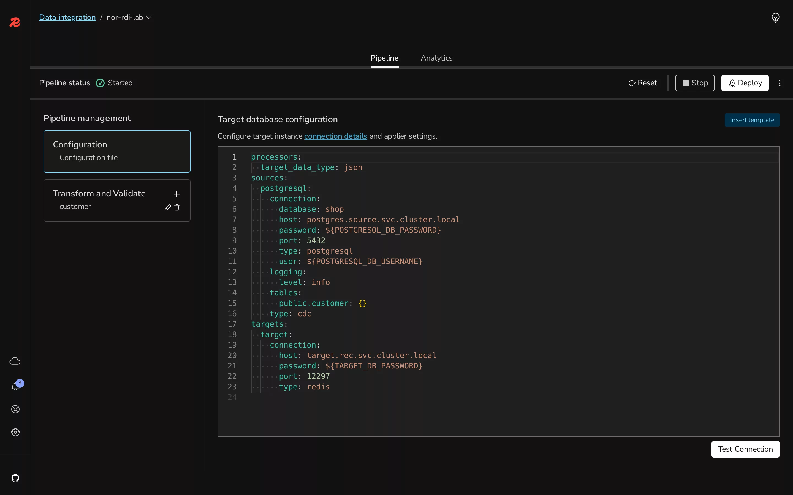

# Redis Data Integration

[English](#english) | [한국어](#한국어)

## English

**Verified on RDI 2.2.1 (Debezium 3.5.0.Final-rdi.3, Flink processor) from Postgres 17.11 into Redis Enterprise 8.2.6-25 on kind (`03-operator-kind`), 2026-11-07.**

RDI copies a relational table into Redis and keeps it current with change data capture. From the overview: "Redis Data Integration (RDI) keeps your Redis cache in sync with a primary system-of-record database in near real time." Here the source is a Postgres pod with 1,000 made-up customers, the target is a Redis Enterprise database, and one job transforms each row on the way: it adds a `tier` field from `credit_limit`, drops `email`, and writes JSON under `customer:<id>`. RDI keeps its own state in a second database, which the install guide requires to be non-clustered: "Ensure that the RDI database is not clustered."

Official documentation: [RDI overview](https://redis.io/docs/latest/integrate/redis-data-integration/), [Install on Kubernetes](https://redis.io/docs/latest/integrate/redis-data-integration/installation/install-k8s/), [Prepare PostgreSQL](https://redis.io/docs/latest/integrate/redis-data-integration/data-pipelines/prepare-dbs/postgresql/), [Pipeline configuration](https://redis.io/docs/latest/integrate/redis-data-integration/data-pipelines/pipeline-config/), [Deploy a pipeline](https://redis.io/docs/latest/integrate/redis-data-integration/data-pipelines/deploy/), [Add a field](https://redis.io/docs/latest/integrate/redis-data-integration/data-pipelines/transform-examples/redis-add-field-example/).

### Run

```bash
../03-operator-kind/up.sh   # the cluster and the two databases RDI needs
./up.sh                     # Postgres, the RDI chart and CLI (downloaded into .rdi/), secrets, pipeline (~3 min)
./cdc.sh                    # time an UPDATE, INSERT, DELETE and a 1,000-row UPDATE until they show in Redis
../03-operator-kind/down.sh
./classic.sh                # the same pipeline on the classic processor, then cdc.sh twice
./least_privilege.sh         # rerun the pipeline as a replication-only Postgres user, then cdc.sh
./insight.sh                 # Redis Insight 3.8.0 connected to the RDI API
```

`up.sh` output as it appeared (2026-11-07):

```text
postgres ready after 16 s: wal_level=logical, rows=1000
RDI 2.2.1 installed after 32 s
   rdi-api-64889d66d7-726sb Running
   rdi-operator-777cf487b-9c656 Running
   rdi-reloader-c5879d5bd-rwx2w Running
Version:               2.2.1
Leader Election Mode:  disabled
Waiting for pipeline default to deploy...
Pipeline default deployed.
pipeline deployed after 67 s
initial snapshot done after 68 s
Name:     default
Active:   yes
Status:   started
Current:  yes

Sources:
  Name        Type  Db Type     Connection                              Sync Mode  Connected
  ----        ----  -------     ----------                              ---------  ---------
  postgresql  cdc   postgresql  postgres.source.svc.cluster.local:5432  streaming  yes

Targets:
  Name    Db Type  Connection                          Connected
  ----    -------  ----------                          ---------
  target  redis    target.rec.svc.cluster.local:13007  no

Processor:
  Type:  flink
  Properties:
    target_data_type:  json

Jobs:
  Name      Server Name  Db / Schema  Table     Transformations  Outputs  Connections
  ----      -----------  -----------  -----     ---------------  -------  -----------
  customer  postgresql   public       customer  2                1        target

Components:
  Name                  Type                Version            Status   Metrics Endpoints
  ----                  ----                -------            ------   -----------------
  collector-api         collector-api       2.2.1              started  
  collector-postgresql  debezium-collector  3.5.0.Final-rdi.3  started  
  flink-processor       flink-processor     2.2.1              started  

Statistics:
  Name                        Incoming  Pending  Inserted  Updated  Deleted  Filtered  Rejected  Last Arrival
  ----                        --------  -------  --------  -------  -------  --------  --------  ------------
  postgresql.public.customer  1000      0        1000      0        0        0         0         2026-11-07T10:44:45Z

Performance:
  Job:          running, uptime 0h0m, 0 restarts
  Throughput:   source 0/s, sink 0/s
  Utilization:  busy 0%, idle 0%, back-pressured 0%
  Checkpoints:  last 9ms (1092 B), 4 completed, 0 failed
```

`cdc.sh` output as it appeared (2026-11-07), three runs in a row:

```text
##### run 1
== UPDATE one row: customer 7 credit_limit -> 9000 + run number (tier gold)
   visible after 1476 ms
== INSERT one row: customer 1001
   visible after 839 ms
== DELETE one row: customer 1
   gone after 411 ms
== UPDATE every row in one transaction (1000 rows): credit_limit + 1, watching customer 1001
   all updates visible after 1495 ms
== the overhead in these numbers: one kubectl exec of psql that changes nothing
   114 ms
== the transformation on the new row
{"id":1001,"name":"customer-1001","country":"KR","credit_limit":2001,"tier":"standard"}
##### run 2
== UPDATE one row: customer 7 credit_limit -> 9000 + run number (tier gold)
   visible after 197 ms
== INSERT one row: customer 1002
   visible after 1144 ms
== DELETE one row: customer 2
   gone after 773 ms
== UPDATE every row in one transaction (1000 rows): credit_limit + 1, watching customer 1002
   all updates visible after 805 ms
== the overhead in these numbers: one kubectl exec of psql that changes nothing
   112 ms
== the transformation on the new row
{"id":1002,"name":"customer-1002","country":"KR","credit_limit":2001,"tier":"standard"}
##### run 3
== UPDATE one row: customer 7 credit_limit -> 9000 + run number (tier gold)
   visible after 197 ms
== INSERT one row: customer 1003
   visible after 1139 ms
== DELETE one row: customer 3
   gone after 1124 ms
== UPDATE every row in one transaction (1000 rows): credit_limit + 1, watching customer 1003
   all updates visible after 1292 ms
== the overhead in these numbers: one kubectl exec of psql that changes nothing
   118 ms
== the transformation on the new row
{"id":1003,"name":"customer-1003","country":"KR","credit_limit":2001,"tier":"standard"}
```

The pipeline is [`pipeline/config.yaml.in`](./pipeline/config.yaml.in) (the target port is filled in at run time) and [`pipeline/jobs/customer.yaml`](./pipeline/jobs/customer.yaml).

`classic.sh` output as it appeared (2026-11-07):

```text
== pods with the Flink processor
   collector-api
   collector-postgresql
   flink-processor-jobmanager
   flink-processor-taskmanager
   rdi-api
   rdi-operator
   rdi-reloader
   processors:
     type: classic
     target_data_type: json
Waiting for pipeline default to deploy...
Pipeline default deployed.
redeployed after 40 s
== pods with the classic processor
   collector-api
   collector-postgresql
   processor
   rdi-api
   rdi-metrics-exporter
   rdi-operator
   rdi-reloader
Processor:
  Type:  classic
  Properties:
    target_data_type:  json

Jobs:
Statistics:
  Name                        Total  Pending  Inserted  Updated  Deleted  Filtered  Rejected  Deduplicated  Last Arrival
  ----                        -----  -------  --------  -------  -------  --------  --------  ------------  ------------
  postgresql.public.customer  0      0        0         0        0        0         0         0             2026-11-07T12:25:44Z

##### cdc.sh run 1
== UPDATE one row: customer 7 credit_limit -> 9000 + run number (tier gold)
   visible after 1103 ms
== INSERT one row: customer 1001
   visible after 772 ms
== DELETE one row: customer 1
   gone after 995 ms
== UPDATE every row in one transaction (1000 rows): credit_limit + 1, watching customer 1001
   all updates visible after 794 ms
== the overhead in these numbers: one kubectl exec of psql that changes nothing
   109 ms
== the transformation on the new row
{"id":1001,"name":"customer-1001","country":"KR","credit_limit":2001,"tier":"standard"}
##### cdc.sh run 2
== UPDATE one row: customer 7 credit_limit -> 9000 + run number (tier gold)
   visible after 211 ms
== INSERT one row: customer 1002
   visible after 944 ms
== DELETE one row: customer 2
   gone after 781 ms
== UPDATE every row in one transaction (1000 rows): credit_limit + 1, watching customer 1002
   all updates visible after 1035 ms
== the overhead in these numbers: one kubectl exec of psql that changes nothing
   133 ms
== the transformation on the new row
{"id":1002,"name":"customer-1002","country":"KR","credit_limit":2001,"tier":"standard"}
```

`least_privilege.sh` and `insight.sh` output as it appeared (2026-11-07):

```text
== create the user and the replication group
rdi: superuser=true, replication=true, createdb=true
rdi_cdc: superuser=false, replication=true, createdb=false
== what rdi_cdc cannot do
ERROR:  permission denied to create role
1000
== switch the pipeline's source secrets to rdi_cdc and reset it (new snapshot as that user)
Pipeline default reset.
snapshot as rdi_cdc done after 30 s
Sources:
  Name        Type  Db Type     Connection                              Sync Mode  Connected
  ----        ----  -------     ----------                              ---------  ---------
  postgresql  cdc   postgresql  postgres.source.svc.cluster.local:5432  streaming  yes

Statistics:
  Name                        Incoming  Pending  Inserted  Updated  Deleted  Filtered  Rejected  Last Arrival
  ----                        --------  -------  --------  -------  -------  --------  --------  ------------
  postgresql.public.customer  1000      0        1000      0        0        0         0         2026-11-07T13:49:58Z

replication connection as rdi_cdc, streaming
replication slot debezium active=true
publication dbz_publication owner rdi
== UPDATE one row: customer 7 credit_limit -> 9000 + run number (tier gold)
   visible after 194 ms
== INSERT one row: customer 1002
   visible after 2911 ms
== DELETE one row: customer 2
   gone after 673 ms
== UPDATE every row in one transaction (1000 rows): credit_limit + 1, watching customer 1002
   all updates visible after 807 ms
== the overhead in these numbers: one kubectl exec of psql that changes nothing
   125 ms
== the transformation on the new row
{"id":1002,"name":"customer-1002","country":"KR","credit_limit":2001,"tier":"standard"}

$ ./insight.sh
registered nor-rdi-lab RDI version 2.2.1
open http://127.0.0.1:25540/integrate   (docker rm -f nor-insight-rdi when done)
```

### What was observed

- **The chart is small and quick.** The RDI chart installed in 32 s and started three pods: API, operator and reloader. The collector and processor pods appear only when a pipeline is deployed.
- **Flink is the default processor.** The config set no processor type, and `redis-di describe` showed `Type: flink` with a job manager and a task manager pod. The release notes list "Flink as the default processor" from RDI 2.0.0.
- **Deploy and initial snapshot.** `redis-di deploy` took 67 s, and the 1,000 rows were in Redis 1 s later, already transformed. The target held 1,001 keys: the customers plus a counter that `03`'s failover test left behind.
- **Change latency.** From issuing the SQL to the change being readable in Redis, three runs: one-row UPDATE 0.2–1.5 s, INSERT 0.8–1.1 s, DELETE 0.4–1.1 s, a 1,000-row UPDATE in one transaction 0.8–1.5 s. Each figure includes about 0.11 s of `kubectl exec` and the watcher's 20 ms polling. In an earlier session, the first change after the snapshot took 3.9 s and later ones 0.2–0.9 s.
- **Deletes delete.** Deleting a row removed its key.
- **"Connected: no" for the target.** `redis-di describe` showed the target as not connected even while rows were arriving in it. It was not investigated further.
- **The classic processor runs in one pod.** With `processors.type: classic` the redeploy took 40 s and replaced Flink's job manager and task manager with a single `processor` pod plus `rdi-metrics-exporter`. Change latency stayed in the same range: 0.2–1.1 s over two runs. The statistics counters started again from zero after the switch.
- **Write-behind is not part of RDI 2.2.** The RDI 2.2 documentation has no write-behind (Redis to a database) section. The write-behind pages that remain describe an older engine that needs RedisGears Python 1.2.6 on the cluster, and Redis Software 8.2.6-25 ships no RedisGears ([`01`](../01-redis-software-docker/README.md)). It could not be run here.
- **A replication-only Postgres user is enough.** Following the "replication group" steps on RDI's PostgreSQL page, `rdi_cdc` has `LOGIN REPLICATION` and `CREATE` on the database, shares table ownership through `replication_group`, and is not a superuser: `CREATE ROLE` was refused. After switching the source secrets and `redis-di reset`, the 1,000-row snapshot ran again as `rdi_cdc` in 30 s, `pg_stat_replication` showed the stream as `rdi_cdc`, and the change latencies were in the same range as before. The publication `dbz_publication` was still owned by the superuser that created it in the first run.
- **Redis Insight shows the pipeline.** Redis Insight 3.8.0 registered the RDI API (it read version 2.2.1) and showed the pipeline status, the configuration with secrets as `${...}` placeholders, and the `customer` job, with **Deploy**, **Reset** and **Stop**. Its **Analytics** tab stayed empty for this Flink pipeline.



Captured 2026-11-07, headless Chromium on the lab host.

### Not run / caveats

- Not production settings: no TLS and no replica for the RDI database; `up.sh` still starts with the superuser and `least_privilege.sh` switches to `rdi_cdc`.
- Latency comes from one host with all components on it; it is an order of magnitude, not a benchmark.
- Managed RDI on Redis Cloud is Pro only ([#12](https://github.com/litkhai/notes-on-redis/issues/12)).

| | |
|---|---|
| Plan needed | Free (local kind, Redis Enterprise trial licence) |
| Verified on | RDI 2.2.1 (Debezium 3.5.0.Final-rdi.3, Flink processor) from Postgres 17.11 into Redis Enterprise 8.2.6-25 on kind (`03-operator-kind`), 2026-11-07 |

## 한국어

**확인: RDI 2.2.1 (Debezium 3.5.0.Final-rdi.3, Flink processor) from Postgres 17.11 into Redis Enterprise 8.2.6-25 on kind (`03-operator-kind`), 2026-11-07.**

RDI는 관계형 테이블을 Redis로 복사하고 변경 데이터 캡처(CDC)로 최신 상태를 유지한다. 개요의 표현: "Redis Data Integration (RDI) keeps your Redis cache in sync with a primary system-of-record database in near real time." 여기서 원천은 가상의 고객 1,000명이 든 Postgres 파드, 대상은 Redis Enterprise DB이고, 작업 하나가 행마다 변환한다: `credit_limit`에서 `tier` 필드를 만들고, `email`을 빼고, `customer:<id>`에 JSON으로 쓴다. RDI는 자기 상태를 두 번째 DB에 두며, 설치 가이드는 그 DB가 클러스터가 아니어야 한다고 적는다: "Ensure that the RDI database is not clustered."

공식 문서: [RDI overview](https://redis.io/docs/latest/integrate/redis-data-integration/), [Install on Kubernetes](https://redis.io/docs/latest/integrate/redis-data-integration/installation/install-k8s/), [Prepare PostgreSQL](https://redis.io/docs/latest/integrate/redis-data-integration/data-pipelines/prepare-dbs/postgresql/), [Pipeline configuration](https://redis.io/docs/latest/integrate/redis-data-integration/data-pipelines/pipeline-config/), [Deploy a pipeline](https://redis.io/docs/latest/integrate/redis-data-integration/data-pipelines/deploy/), [Add a field](https://redis.io/docs/latest/integrate/redis-data-integration/data-pipelines/transform-examples/redis-add-field-example/).

### 실행

```bash
../03-operator-kind/up.sh   # the cluster and the two databases RDI needs
./up.sh                     # Postgres, the RDI chart and CLI (downloaded into .rdi/), secrets, pipeline (~3 min)
./cdc.sh                    # time an UPDATE, INSERT, DELETE and a 1,000-row UPDATE until they show in Redis
../03-operator-kind/down.sh
./classic.sh                # the same pipeline on the classic processor, then cdc.sh twice
./least_privilege.sh         # rerun the pipeline as a replication-only Postgres user, then cdc.sh
./insight.sh                 # Redis Insight 3.8.0 connected to the RDI API
```

출력은 영문 절과 같다(2026-11-07). 파이프라인은 [`pipeline/config.yaml.in`](./pipeline/config.yaml.in)(대상 포트는 실행 때 채움)과 [`pipeline/jobs/customer.yaml`](./pipeline/jobs/customer.yaml)이다.

`classic.sh`의 출력도 영문 절과 같다(2026-11-07).

`least_privilege.sh` and `insight.sh`의 출력도 영문 절과 같다(2026-11-07).

### 관찰한 것

- **차트는 작고 빠르다.** RDI 차트는 32초에 설치되고 파드 셋을 띄웠다: API, operator, reloader. collector와 processor 파드는 파이프라인을 배포해야 생긴다.
- **기본 프로세서는 Flink다.** 설정에 프로세서 종류를 적지 않았는데 `redis-di describe`가 `Type: flink`와 job manager, task manager 파드를 보여 줬다. 릴리스 노트는 RDI 2.0.0부터 "Flink as the default processor"라고 적는다.
- **배포와 초기 스냅샷.** `redis-di deploy`가 67초 걸렸고 1초 뒤 1,000행이 이미 변환된 채 Redis에 있었다. 대상의 키는 1,001개: 고객과, `03`의 장애 조치 시험이 남긴 카운터 하나.
- **변경 지연.** SQL을 보낸 때부터 Redis에서 읽힐 때까지, 세 번 실행: 한 행 UPDATE 0.2–1.5초, INSERT 0.8–1.1초, DELETE 0.4–1.1초, 한 트랜잭션의 1,000행 UPDATE 0.8–1.5초. 수치마다 `kubectl exec` 약 0.11초와 감시자의 20 ms 폴링이 들어 있다. 이전 세션에서는 스냅샷 뒤 첫 변경이 3.9초, 이후는 0.2–0.9초였다.
- **삭제는 삭제된다.** 행을 지우면 키가 사라졌다.
- **대상이 "Connected: no".** 행이 들어오는 동안에도 `redis-di describe`는 대상을 연결 안 됨으로 표시했다. 더 조사하지 않았다.
- **classic 프로세서는 파드 하나로 돈다.** `processors.type: classic`으로 다시 배포하는 데 40초가 걸렸고, Flink의 job manager와 task manager 대신 `processor` 파드 하나와 `rdi-metrics-exporter`가 떴다. 변경 지연은 두 번 실행에서 0.2–1.1초로 같은 범위였다. 바꾼 뒤 통계 카운터는 0부터 다시 시작했다.
- **write-behind는 RDI 2.2에 없다.** RDI 2.2 문서에는 write-behind(Redis에서 DB로) 절이 없다. 남아 있는 write-behind 페이지는 클러스터에 RedisGears Python 1.2.6이 필요한 예전 엔진을 설명하는데, Redis Software 8.2.6-25에는 RedisGears가 없다([`01`](../01-redis-software-docker/README.md)). 여기서는 실행할 수 없었다.
- **복제 전용 Postgres 사용자로 충분하다.** RDI PostgreSQL 페이지의 "replication group" 절차대로 만든 `rdi_cdc`는 `LOGIN REPLICATION`과 DB에 대한 `CREATE` 권한을 갖고, `replication_group`으로 테이블 소유권을 공유하며, 슈퍼유저가 아니다: `CREATE ROLE`은 거절됐다. 원천 시크릿을 바꾸고 `redis-di reset`하자 1,000행 스냅샷이 `rdi_cdc`로 30초에 다시 돌았고, `pg_stat_replication`은 스트림 사용자를 `rdi_cdc`로 보여 줬으며, 변경 지연은 이전과 같은 범위였다. 발행(publication) `dbz_publication`은 첫 실행에서 그것을 만든 슈퍼유저 소유 그대로였다.
- **Redis Insight가 파이프라인을 보여 준다.** Redis Insight 3.8.0은 RDI API를 등록하고(버전 2.2.1을 읽음) 파이프라인 상태, 시크릿이 `${...}` 자리표시자로 보이는 설정, `customer` 작업을 **Deploy**, **Reset**, **Stop**과 함께 보여 줬다. **Analytics** 탭은 이 Flink 파이프라인에서 비어 있었다.


2026-11-07 캡처, 실습 호스트의 headless Chromium.

### 미실행 / 주의

- 운영 설정이 아니다: RDI DB에 TLS와 복제본이 없다. `up.sh`는 여전히 슈퍼유저로 시작하고 `least_privilege.sh`가 `rdi_cdc`로 바꾼다.
- 지연은 모든 구성 요소가 호스트 하나에 있는 상태에서 쟀다. 규모를 보는 값이지 벤치마크가 아니다.
- Redis Cloud의 관리형 RDI는 Pro 전용이다([#12](https://github.com/litkhai/notes-on-redis/issues/12)).

| | |
|---|---|
| 필요한 플랜 | Free(로컬 kind, Redis Enterprise 체험 라이선스) |
| 확인한 버전 | RDI 2.2.1 (Debezium 3.5.0.Final-rdi.3, Flink processor) from Postgres 17.11 into Redis Enterprise 8.2.6-25 on kind (`03-operator-kind`), 2026-11-07 |
