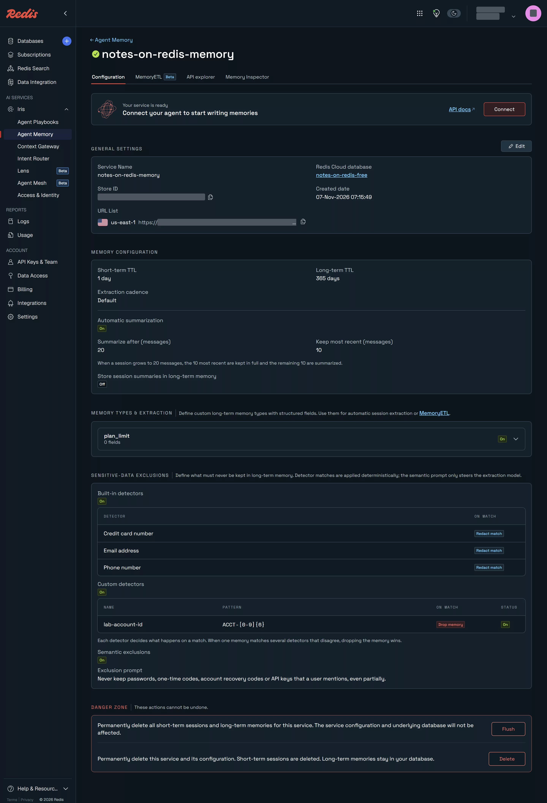

# Agent Memory

[English](#english) | [한국어](#한국어)

## English

**Verified on redis-iris 1.0.1 against Redis Cloud free plan services (endpoints in us-east-1, database in ap-northeast-2), 2026-11-07.**

The service from `iris/01`, taken further: a long session and its summary, a shared namespace, made-up personal data with the built-in detectors off and then on, MemoryETL turning a document into typed memories, and `forget()`.

Official documentation: [Agent Memory](https://redis.io/docs/latest/operate/iris/agent-memory/)

### Run

```bash
.venv/bin/python lab.py sessions
.venv/bin/python lab.py namespace
PII_RUN=off .venv/bin/python lab.py pii     # built-in detectors off
# console: Configuration > Edit > Sensitive-data exclusions > Built-in detectors: email, phone, credit card, Redact match
PII_RUN=on  .venv/bin/python lab.py pii
.venv/bin/python lab.py forget
# console: Add type plan_limit; MemoryETL > New extractor plan-limits-from-docs
.venv/bin/python etl.py                     # submits free-plan-limits.md
# console: Configuration > Edit > Sensitive-data exclusions: custom detector lab-account-id, ACCT-[0-9]{6}, Drop memory;
#   semantic exclusions on, prompt about passwords, one-time codes, recovery codes and API keys
.venv/bin/python detectors.py   # a direct write and an extracted conversation, then forget both test owners
```

Output as it appeared (2026-11-07; service ids and endpoints removed):

```text
$ lab.py sessions
== sessions
session: cust-2001-20261107081802
t+ 0s: events kept 14; summary: The conversation covers sizing Redis Cloud databases for session data ranging from 100 MB to 500 MB. In each case, the guidance is to choose the next available …
with summarised events included: 24

$ lab.py namespace
== namespace
create_namespace: ConflictErrorResponseContent {"detail":"An exact root or sibling namespace already exists","status":409,"title":"Namespace Already Exists","type":"/errors/conflict"}
existing namespace: ns_<id>
shared memory: Support policy: Redis Cloud free databases cannot enable TLS; recommend Essentials for production.
recall as cust-3001 with shared=none: []
recall as cust-3001 with shared=['ns_<id>']: ['Support policy: Redis Cloud free databases cannot enable TLS; recommend Essentials for production.']

$ PII_RUN=off lab.py pii   (later check at 08:25 UTC)
== pii
owner: cust-pii-off session: cust-pii-off-20261107082013
t+  0s: []
t+ 30s: []
t+ 60s: []
t+ 90s: []
t+120s: []
08:24:05 cust-pii-off long-term: []

$ PII_RUN=on lab.py pii
== pii
owner: cust-pii-on session: cust-pii-on-20261107082557
t+  0s: []
t+ 30s: []
t+ 60s: []
t+ 90s: []
t+120s: []
t+150s: []
t+180s: []
t+210s: []
t+240s: ["User's phone number is [REDACTED].", "User's email address is [REDACTED].", 'User prefers to be contacted by email about Redis Cloud invoices.']

$ lab.py forget
== forget
cust-2001: memories 20 -> 0; Forgotten(owner='cust-2001', sessions=1, memories=25)
cust-pii-off: memories 3 -> 0; Forgotten(owner='cust-pii-off', sessions=1, memories=3)
cust-pii-on: memories 3 -> 0; Forgotten(owner='cust-pii-on', sessions=1, memories=3)

$ etl.py
submitted: RUNNING
SUCCEEDED after 183 s: chunks 1/1, created 8, filtered 0, error None
memories created: 8
  [plan_limit] On 2026-11-07, the Redis Cloud free plan advertises a limit of 100 operations per second, but it was not enforced: about 104,000 operations per second ran for 60 seconds without errors.
  [plan_limit] On 2026-11-07, the Redis Cloud free plan allows one database with a memory size of 30 MB in a region you choose.
  [plan_limit] On 2026-11-07, the Redis Cloud free plan allows 30 connections; the 31st connection is refused with "max number of clients reached".
  [plan_limit] On 2026-11-07, the Redis Cloud free plan has no persistence.
  [plan_limit] On 2026-11-07, the Redis Cloud free plan has no replication.
  [plan_limit] On 2026-11-07, the Redis Cloud free plan has no backups.
  [plan_limit] On 2026-11-07, writes on the Redis Cloud free plan stop with an OOM error at about 28 MB of values.
  [plan_limit] On 2026-11-07, TLS cannot be turned on for a Redis Cloud free database; the API refuses enableTls.
```

`detectors.py` output as it appeared (2026-11-07):

```text
== direct writes (remember)
   remember('Customer account ACCT-654321 is on the support plan.') -> stored: 'Customer account ACCT-654321 is on the support plan.'
   remember('The customer prefers invoices by email.') -> stored: 'The customer prefers invoices by email.'
   memories now: ['The customer prefers invoices by email.', 'Customer account ACCT-654321 is on the support plan.']

== a conversation, extracted in the background
     31 s: nothing extracted yet
     62 s: nothing extracted yet
     92 s: nothing extracted yet
    123 s: nothing extracted yet
   after 185 s, long-term memories for this owner:
    - User usually deploys on Friday evenings.
    - The user wants all invoices sent by email.
    - User wants all invoices sent by email.
    - The user wants new databases created in the Seoul region.
    - User wants new databases created in the Seoul region.
    - User wants maintenance scheduled outside Friday evenings.
    - The user usually deploys on Friday evenings and prefers maintenance not to be scheduled during that time.

both test owners forgotten
```

### What was observed

- **Summaries.** After 24 messages the session kept 14 events plus a summary of the rest; all 24 are still readable with `include_summarised_events=True`. The setting is "summarize after 20, keep 10": 10 kept at the summary plus the 4 that came after.
- **Extraction is generous.** The same 24-message session produced 25 long-term memories for one owner, mostly one episodic memory per assistant answer. Plan memory types or exclusions if that is noise for you.
- **Shared namespaces.** A memory written into a `SHARED` namespace was returned to another owner only when that namespace was passed as `shared`. Memory ids are derived from owner and text, so writing the same text again is a no-op: the first, namespace-less write here had to be redone under a new owner.
- **Personal data.** With detectors off, the email and the phone number became memories verbatim ("User's email address is jane.doe@example.com"). With email, phone and credit-card detectors on and "Redact match", the same conversation stored "User's email address is [REDACTED]" and "User's phone number is [REDACTED]". The phone detector lists US, CA, UK, DE, IL, IN and BR, yet the +82 number was redacted: numbers with a country code are matched on their own.
- **Timing.** Extraction took about 15 s in `iris/01` but 4–5 minutes in these runs; it runs in the background on its own schedule.
- **MemoryETL (beta).** A custom memory type (`plan_limit`, with an extraction prompt) and an extractor turned a 9-line Markdown document into 8 `plan_limit` memories in 183 s; prices were left out as the prompt asked.
- **Forget.** `forget(owner)` removed the owner's sessions and long-term memories in one call (25, 3 and 3 here).
- **Custom detectors and semantic exclusions are console settings.** The service's **Sensitive-data exclusions** section takes a detector name, a regular expression and an action (**Redact match** or **Drop memory**), and a free-text exclusion prompt of up to 2,000 characters that the console marks "Advisory only: this steers the extraction model but does not guarantee exclusion, and sensitive text still reaches the model provider. Not applied to direct writes."
- **Direct writes skip them.** `remember("Customer account ACCT-654321 is on the support plan.")` was stored verbatim despite the `ACCT-[0-9]{6}` detector set to drop. The developer guide says so: "Direct creation does not wait for background extraction and does not apply the extraction prompt or sensitive-data exclusions."
- **Extraction applied them.** From a conversation that mentioned `ACCT-123456` and a made-up recovery code, background extraction kept seven memories after 185 s: the email preference, the Seoul region, the Friday deployments. None contained the account number or the code. This run cannot tell a detector drop from the model leaving the text out, and the exclusion is advisory, so treat it as one observation, not a guarantee.
- **Extraction repeats itself.** Several memories came in two near-identical wordings ("The user wants…" and "User wants…").



Captured 2026-11-07, Redis Cloud free plan.

### Not run / caveats

- The custom memory type kept "Use for session extraction" on; the switch did not turn off from automation.
- Message consumption is still not visible in the console.

| | |
|---|---|
| Plan needed | Free (Redis Cloud free database; Iris free messages) |
| Verified on | redis-iris 1.0.1 against Redis Cloud free plan services (endpoints in us-east-1, database in ap-northeast-2), 2026-11-07 |

## 한국어

**확인: redis-iris 1.0.1 against Redis Cloud free plan services (endpoints in us-east-1, database in ap-northeast-2), 2026-11-07.**

`iris/01`의 서비스로 더 들어간다. 긴 세션과 요약, 공유 네임스페이스, 내장 탐지기를 끈 상태와 켠 상태의 가짜 개인 정보, 문서를 유형 있는 기억으로 바꾸는 MemoryETL, `forget()`.

공식 문서: [Agent Memory](https://redis.io/docs/latest/operate/iris/agent-memory/)

### 실행

```bash
.venv/bin/python lab.py sessions
.venv/bin/python lab.py namespace
PII_RUN=off .venv/bin/python lab.py pii     # built-in detectors off
# console: Configuration > Edit > Sensitive-data exclusions > Built-in detectors: email, phone, credit card, Redact match
PII_RUN=on  .venv/bin/python lab.py pii
.venv/bin/python lab.py forget
# console: Add type plan_limit; MemoryETL > New extractor plan-limits-from-docs
.venv/bin/python etl.py                     # submits free-plan-limits.md
# console: Configuration > Edit > Sensitive-data exclusions: custom detector lab-account-id, ACCT-[0-9]{6}, Drop memory;
#   semantic exclusions on, prompt about passwords, one-time codes, recovery codes and API keys
.venv/bin/python detectors.py   # a direct write and an extracted conversation, then forget both test owners
```

출력은 영문 절과 같다(2026-11-07).

`detectors.py`의 출력도 영문 절과 같다(2026-11-07).

### 관찰한 것

- **요약.** 메시지 24개 뒤 세션에는 이벤트 14개와 나머지의 요약이 남았다. `include_summarised_events=True`로 24개 모두 읽을 수 있다. 설정은 "20개에서 요약, 10개 유지"다. 요약 때 남은 10개와 그 뒤의 4개.
- **추출이 넉넉하다.** 같은 24개 메시지 세션에서 소유자 한 명에게 장기 기억 25개가 생겼다. 대부분 어시스턴트 답마다 하나씩인 일화 기억이다. 잡음이라면 기억 유형이나 제외 규칙을 설계한다.
- **공유 네임스페이스.** `SHARED` 네임스페이스에 쓴 기억은 다른 소유자가 그 네임스페이스를 `shared`로 넘길 때만 돌아왔다. 기억 ID는 소유자와 본문으로 정해져, 같은 본문을 다시 쓰면 아무 일도 없다. 처음에 네임스페이스 없이 쓴 것을 새 소유자로 다시 써야 했다.
- **개인 정보.** 탐지기를 끄면 이메일과 전화번호가 그대로 기억이 됐다("User's email address is jane.doe@example.com"). 이메일·전화·신용카드 탐지기를 "Redact match"로 켜자 같은 대화가 "User's email address is [REDACTED]", "User's phone number is [REDACTED]"로 저장됐다. 전화 탐지기의 대상 국가는 US, CA, UK, DE, IL, IN, BR이지만 +82 번호도 가려졌다. 국가 번호가 붙은 번호는 그 자체로 매칭된다.
- **시간.** 추출은 `iris/01`에서 약 15초였지만 이번에는 4–5분이었다. 백그라운드에서 자체 일정으로 돈다.
- **MemoryETL(베타).** 사용자 정의 기억 유형(`plan_limit`, 추출 프롬프트 포함)과 extractor가 9줄짜리 Markdown 문서를 183초 만에 `plan_limit` 기억 8개로 바꿨다. 프롬프트대로 가격은 빠졌다.
- **삭제.** `forget(owner)` 한 번에 소유자의 세션과 장기 기억이 지워졌다(여기서는 25, 3, 3).
- **사용자 정의 탐지기와 의미 기반 제외는 콘솔 설정이다.** 서비스의 **Sensitive-data exclusions** 절에서 탐지기 이름, 정규식, 동작(**Redact match** 또는 **Drop memory**)과 최대 2,000자의 제외 프롬프트를 받는다. 콘솔은 프롬프트에 "Advisory only: this steers the extraction model but does not guarantee exclusion, and sensitive text still reaches the model provider. Not applied to direct writes."라고 적는다.
- **직접 쓰기는 이를 건너뛴다.** 버리도록 설정한 `ACCT-[0-9]{6}` 탐지기가 있는데도 `remember("Customer account ACCT-654321 is on the support plan.")`가 그대로 저장됐다. 개발자 가이드도 그렇게 적는다: "Direct creation does not wait for background extraction and does not apply the extraction prompt or sensitive-data exclusions."
- **추출에서는 적용됐다.** `ACCT-123456`과 가상의 복구 코드가 나온 대화에서 백그라운드 추출이 185초 뒤 기억 일곱 개를 남겼다: 이메일 선호, 서울 리전, 금요일 배포. 계정 번호나 코드가 든 기억은 없었다. 이 실행만으로는 탐지기가 버린 것인지 모델이 빼놓은 것인지 구분할 수 없고 제외는 권고 수준이므로, 보장이 아니라 관찰 한 번으로 읽는다.
- **추출이 겹친다.** 여러 기억이 거의 같은 두 문장("The user wants…"와 "User wants…")으로 들어왔다.


2026-11-07 캡처, Redis Cloud 무료 플랜.

### 미실행 / 주의

- 사용자 정의 기억 유형의 "Use for session extraction"은 켜진 채로 남았다. 자동화로는 꺼지지 않았다.
- 메시지 사용량은 여전히 콘솔에 보이지 않는다.

| | |
|---|---|
| 필요한 플랜 | Free(Redis Cloud 무료 DB, Iris 무료 메시지) |
| 확인한 버전 | redis-iris 1.0.1 against Redis Cloud free plan services (endpoints in us-east-1, database in ap-northeast-2), 2026-11-07 |
