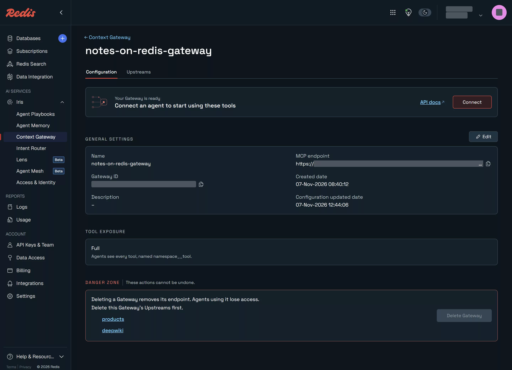
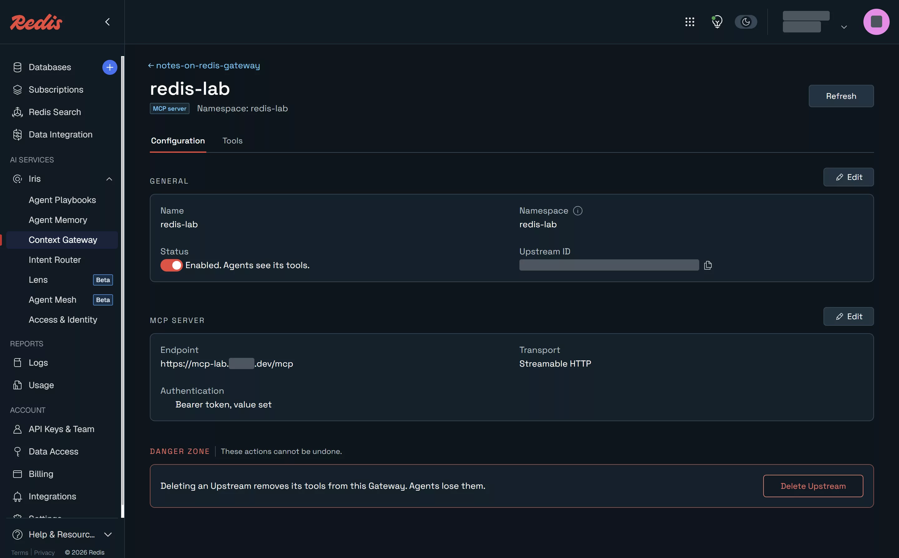

# Context Gateway

[English](#english) | [한국어](#한국어)

## English

**Verified on redis-iris 1.0.1 against Redis Cloud free plan services (endpoints in us-east-1, database in ap-northeast-2), 2026-11-07.**

One Gateway, two upstreams: a Context Surface generated from 30 made-up products in the free database, and the public DeepWiki MCP server; later mcp-redis as a third, through a tunnel. Tool exposure in search mode, so an agent sees two tools and finds the rest by searching.

Official documentation: [Context Gateway](https://redis.io/docs/latest/operate/iris/context-gateway/)

### Run

```bash
../../cloud/01-free-database/.venv/bin/python seed.py     # 30 product:NNN hashes
# console: New Gateway (Search) > Create Context Surface: entity Product, key product:{id}, Hash,
#   fields id (PK), name (text), category/colour (tag), price/stock (int, numeric)
# console: Add MCP server deepwiki https://mcp.deepwiki.com/mcp, no auth
.venv/bin/python lab.py
# console: Configuration > Edit > Tool exposure: Full, Save; then back to Search
.venv/bin/python exposure.py   # what an agent sees in the current mode
# mcp-redis upstream (2026-11-07): throwaway local Redis, HTTP wrapper with a bearer token, tunnel
docker run -d --name nor-mcp-redis -p 127.0.0.1:26379:6379 redis:8 && mcp-redis/seed.sh
(cd mcp-redis && uv venv -p 3.12 .venv && VIRTUAL_ENV=.venv uv pip install -r requirements.txt)
# mcp-redis/.env: MCP_TOKEN=<random>, MCP_PUBLIC_HOST=<public hostname>
(cd mcp-redis && set -a && . ./.env && set +a && .venv/bin/python serve_http.py) &
cloudflared tunnel create <name> && cloudflared tunnel route dns <name> <public hostname>
cloudflared tunnel run --url http://127.0.0.1:28090 <name> &
# console: Add MCP server redis-lab https://<public hostname>/mcp, no auth (refused); then Edit > Add bearer token
.venv/bin/python mcp-redis/lab.py
# afterwards: Delete Upstream; stop the wrapper and tunnel; cloudflared tunnel delete <name>; delete the CNAME
```

Output as it appeared (2026-11-07; service ids and endpoints removed):

```text
1141 ms  tools()
tools the agent sees: ['search_tools', 'run_tool']
  1030 ms  search('black lamps under 100 dollars')
   -> ['products__filter_product']
  1064 ms  search('documentation of a GitHub repository')
   -> ['deepwiki__read_wiki_structure', 'products__expand_results', 'deepwiki__read_wiki_contents']
filter_product input schema keys: ['limit', 'numeric_conditions', 'offset', 'sort_by', 'sort_order', 'tag_conditions']
  2442 ms  call products__filter_product (black lamps, price <= 100)
   -> ToolResult(text='{"count":3,"has_more":false,"limit":10,"offset":0,"results":[{"category":"lamp","colour":"black","name":"black floor lamp","price":29,"stock":23},{"category":"lamp","colour":"black","name":"black desk lamp","price":79,"stock":9},{"category":"lamp","colour":"black","name":"black reading lamp","price":29,"stock":5}],"total_count":3}', data={'count': 3, 'has_more': False, 'limit': 10, 'offset': 0, 'results': [{'category': 'lamp', 'colour': 'black', 'name': 'black floor lamp',
  2390 ms  call products__count_product (function=count)
   -> ToolResult(text='{"function":"count","value":30}', data={'function': 'count', 'value': 30}, is_error=False)
  1505 ms  call deepwiki__read_wiki_structure redis/redis
   -> ToolResult(text='Available pages for redis/redis:\n\n- 1 Overview\n- 2 Redis Core\n  - 2.1 Server Architecture and Lifecycle\n  - 2.2 Event Loop\n  - 2.3 Client Connection Management\n  - 2.4 Networking and Connection Abstraction\n  - 2.5 Command Processing Pipeline\n  - 2.6 Configuration Management\n  - 2.7 Access Control Lists (ACL)\n  - 2.8 Client-Side Caching and Tracking\n- 3 Data Storage and
```

`exposure.py` output as it appeared (2026-11-07):

```text
-- tool exposure: Full
tools() in 1399 ms: 13 tool(s)
   products__count_product                    Count Product records without retrieving individual records. This tool
   products__except_results                   Return the records in the FIRST set that are not in any of the others 
   products__expand_results                   Follow a declared relationship from one set to the related entity and 
   products__filter_product                   Filter Product by one or MORE field conditions in a single call; a rec
   products__get_product_by_id                Get Product by ID using a key lookup. A furniture product. ID field id
   products__intersect_results                Return the records present in EVERY given set (AND) -- the conjunctive
   products__list_product                     List Product, optionally sorted by a numeric field. Valid sort_by fiel
   products__search_product_by_text           Lexical full-text search (not semantic) for Product. By default, resul
   products__summarize_product                Summarize Product numeric fields without retrieving individual records
   products__union_results                    Return the records present in ANY of the given sets (OR), de-duplicate
   deepwiki__ask_wiki_question                Ask any question about a GitHub repository's codebase and get an AI-po
   deepwiki__read_wiki_contents               View documentation about a GitHub repository.
   deepwiki__read_wiki_structure              Get a list of documentation topics for a GitHub repository.

-- tool exposure: Search
tools() in 1531 ms: 2 tool(s)
   search_tools                               Search the managed tools available through this Gateway. Each match is
   run_tool                                   Run one tool returned by search_tools. Identify it by the upstreamId a
```

`mcp-redis/lab.py` output as it appeared (2026-11-07):

```text
tools the agent sees: ['search_tools', 'run_tool']
  1092 ms  search('read every field of a Redis hash')
   -> ['redis-lab__create_vector_index_hash', 'redis-lab__vector_search_hash', 'redis-lab__set_vector_in_hash', 'redis-lab__get_vector_from_hash']
  1045 ms  search('delete a Redis key')
   -> ['redis-lab__create_vector_index_hash', 'redis-lab__search_redis_documents', 'redis-lab__delete', 'redis-lab__rename']
  2332 ms  search('run any Redis command')
   -> ['redis-lab__search_redis_documents', 'redis-lab__hybrid_search', 'redis-lab__create_vector_index_hash', 'redis-lab__scan_keys']
  3517 ms  call redis-lab__hgetall ticket:1
   -> {
  "title": "made-up ticket 1",
  "status": "open",
  "priority": "1"
}
  3001 ms  call redis-lab__set note:from-gateway
   -> Successfully set note:from-gateway | local GET: written by an agent
  3036 ms  call redis-lab__delete counter:visits
   -> Successfully deleted counter:visits | local EXISTS: 0
```

With exposure set to Full, `exposure.py` listed 66 tools; the 53 from mcp-redis were:

```text
client_list create_vector_index_hash dbsize delete expire get get_index_info get_indexed_keys_number
get_indexes get_vector_from_hash hdel hexists hget hgetall hset hybrid_search info json_del json_get
json_set llen lpop lpush lrange lrem psubscribe publish read_messages rename rpop rpush sadd
scan_all_keys scan_keys search_redis_documents set set_vector_in_hash smembers srem subscribe type
unsubscribe vector_search_hash xack xadd xdel xgroup_create xgroup_destroy xrange xreadgroup zadd
zrange zrem
```

### What was observed

- **Search mode.** The agent's tool list is just `search_tools` and `run_tool`. "black lamps under 100 dollars" found `products__filter_product`; "documentation of a GitHub repository" found the DeepWiki tools first.
- **Context Surface.** From one entity with six fields the Gateway generated ten tools (count, filter, text search, set operations, relationship expansion and more), each with a JSON Schema the Gateway enforces: wrong argument shapes were refused with `invalid_arguments` and the tool was not called. The filter returned the same three black lamps at or under 00 that a direct scan of the database found. It also added a Search index to the database.
- **MCP server.** DeepWiki's three tools appeared as `deepwiki__*`; `read_wiki_structure` for redis/redis returned its page list through the Gateway.
- **Latency from Korea.** `tools()` 1.1–1.5 s, a search about 1 s, Surface calls about 2.4 s, the DeepWiki call 1.5 s.
- **Full exposure lists every tool.** Switched to **Full** in the console, the Gateway gave the agent 13 tools named `namespace__tool`: ten from the `products` Context Surface and three from DeepWiki. Back in **Search**, the agent saw only `search_tools` and `run_tool`. The console calls Search "Recommended for many tools".
- **mcp-redis as an upstream.** mcp-redis 0.5.1 runs over stdio from its CLI, so `mcp-redis/serve_http.py` imports its FastMCP server and serves Streamable HTTP, refusing any request without the bearer token. It ran behind a temporary Cloudflare tunnel against a throwaway local Redis 8.10.3 with made-up keys. Added with no credentials, the upstream was created but discovery failed (422, "the Upstream rejected the Gateway's credentials") and it had no tools; the wrapper logged the refused requests. After **Edit > Add bearer token**, the console said "Saved. Found 53 tools" and shows only "Bearer token, value set"; it never shows the token again.
- **What an agent can do to Redis through it.** Reads and writes on strings, hashes, lists, sets, sorted sets, streams, JSON and vector indexes, plus `delete`, `rename`, `expire`, `scan_all_keys`, `info` and `client_list`. `set` and `delete` through the Gateway changed the local Redis. There is no FLUSHALL, CONFIG or EVAL tool. In Search mode "read every field of a Redis hash" returned four vector tools and not `hgetall`, which the agent then has to name itself. Calls took about 3 s, against 1.5 s for DeepWiki, with the tunnel adding a hop through Cloudflare.
- **Caching and compression are not in the Redis Cloud console.** The Gateway's edit form has name, description and tool exposure only. The docs configure caching and compression with an admin token on the Gateway's administration API, which is how a self-managed deployment is run. Compression would also need a database with JSON and `maxmemory-policy noeviction`, and the free database uses `volatile-lru`.





Captured 2026-11-07, Redis Cloud free plan.

### Not run / caveats

- The mcp-redis upstream ran for about ten minutes and was removed: upstream deleted, wrapper and tunnel stopped, tunnel deleted. Per-upstream tool policies, which the delete dialog mentions, were not tried.
- Result caching and compression could not be set from the Redis Cloud console; they were not run.

| | |
|---|---|
| Plan needed | Free (Redis Cloud free database; Iris free messages) |
| Verified on | redis-iris 1.0.1 against Redis Cloud free plan services (endpoints in us-east-1, database in ap-northeast-2), 2026-11-07 |

## 한국어

**확인: redis-iris 1.0.1 against Redis Cloud free plan services (endpoints in us-east-1, database in ap-northeast-2), 2026-11-07.**

게이트웨이 하나에 업스트림 둘. 무료 DB의 가짜 상품 30개로 만든 Context Surface, 그리고 공개 DeepWiki MCP 서버. 나중에 터널을 거친 mcp-redis를 셋째로 붙였다. 도구 노출은 검색 모드라 에이전트는 도구 둘만 보고 나머지는 검색으로 찾는다.

공식 문서: [Context Gateway](https://redis.io/docs/latest/operate/iris/context-gateway/)

### 실행

```bash
../../cloud/01-free-database/.venv/bin/python seed.py     # 30 product:NNN hashes
# console: New Gateway (Search) > Create Context Surface: entity Product, key product:{id}, Hash,
#   fields id (PK), name (text), category/colour (tag), price/stock (int, numeric)
# console: Add MCP server deepwiki https://mcp.deepwiki.com/mcp, no auth
.venv/bin/python lab.py
# console: Configuration > Edit > Tool exposure: Full, Save; then back to Search
.venv/bin/python exposure.py   # what an agent sees in the current mode
# mcp-redis upstream (2026-11-07): throwaway local Redis, HTTP wrapper with a bearer token, tunnel
docker run -d --name nor-mcp-redis -p 127.0.0.1:26379:6379 redis:8 && mcp-redis/seed.sh
(cd mcp-redis && uv venv -p 3.12 .venv && VIRTUAL_ENV=.venv uv pip install -r requirements.txt)
# mcp-redis/.env: MCP_TOKEN=<random>, MCP_PUBLIC_HOST=<public hostname>
(cd mcp-redis && set -a && . ./.env && set +a && .venv/bin/python serve_http.py) &
cloudflared tunnel create <name> && cloudflared tunnel route dns <name> <public hostname>
cloudflared tunnel run --url http://127.0.0.1:28090 <name> &
# console: Add MCP server redis-lab https://<public hostname>/mcp, no auth (refused); then Edit > Add bearer token
.venv/bin/python mcp-redis/lab.py
# afterwards: Delete Upstream; stop the wrapper and tunnel; cloudflared tunnel delete <name>; delete the CNAME
```

출력은 영문 절과 같다(2026-11-07).

`exposure.py`의 출력도 영문 절과 같다(2026-11-07).

`mcp-redis/lab.py`의 출력과 도구 목록도 영문 절과 같다(2026-11-07).

### 관찰한 것

- **검색 모드.** 에이전트의 도구 목록은 `search_tools`와 `run_tool`뿐이다. "black lamps under 100 dollars"는 `products__filter_product`를, "documentation of a GitHub repository"는 DeepWiki 도구를 먼저 찾았다.
- **Context Surface.** 필드 여섯 개짜리 엔티티 하나에서 게이트웨이가 도구 열 개를 만들었다(개수, 필터, 텍스트 검색, 집합 연산, 관계 확장 등). 각각 게이트웨이가 강제하는 JSON Schema가 있어, 인자 형식이 틀리면 `invalid_arguments`로 거절되고 도구는 호출되지 않았다. 필터는 DB를 직접 훑은 결과와 같은 검은 램프 3개(100달러 이하)를 돌려줬다. DB에 Search 인덱스도 하나 추가됐다.
- **MCP 서버.** DeepWiki 도구 셋이 `deepwiki__*`로 나타났고, redis/redis의 `read_wiki_structure`가 게이트웨이를 거쳐 페이지 목록을 돌려줬다.
- **한국에서의 지연.** `tools()` 1.1–1.5초, 검색 약 1초, Surface 호출 약 2.4초, DeepWiki 호출 1.5초.
- **Full 노출은 모든 도구를 나열한다.** 콘솔에서 **Full**로 바꾸자 게이트웨이가 에이전트에 `namespace__tool` 이름의 도구 13개를 줬다. `products` Context Surface에서 10개, DeepWiki에서 3개. **Search**로 되돌리자 에이전트에는 `search_tools`와 `run_tool`만 보였다. 콘솔은 Search를 "Recommended for many tools"라고 부른다.
- **mcp-redis를 업스트림으로.** mcp-redis 0.5.1은 CLI에서 stdio로만 돌아서, `mcp-redis/serve_http.py`가 그 FastMCP 서버를 가져와 Streamable HTTP로 띄우고 bearer 토큰이 없는 요청은 거부한다. 임시 Cloudflare 터널 뒤에서, 가짜 키를 넣은 일회용 로컬 Redis 8.10.3에 붙였다. 인증 정보 없이 추가하자 업스트림은 생겼지만 탐색이 실패했고(422, "the Upstream rejected the Gateway's credentials") 도구가 없었다. 래퍼 로그에 거부된 요청이 남았다. **Edit > Add bearer token** 뒤에는 콘솔이 "Saved. Found 53 tools"라고 했고, 이후 "Bearer token, value set"만 보여 줄 뿐 토큰은 다시 보여 주지 않는다.
- **이를 거쳐 에이전트가 Redis에 할 수 있는 것.** 문자열, 해시, 리스트, 셋, 정렬 셋, 스트림, JSON, 벡터 인덱스의 읽기·쓰기와 `delete`, `rename`, `expire`, `scan_all_keys`, `info`, `client_list`. 게이트웨이를 거친 `set`과 `delete`가 로컬 Redis를 바꿨다. FLUSHALL, CONFIG, EVAL 도구는 없다. Search 모드에서 "read every field of a Redis hash"는 벡터 도구 넷을 돌려줬고 `hgetall`은 없었다. 이때 에이전트가 이름을 직접 알아야 한다. 호출은 약 3초로 DeepWiki의 1.5초보다 길었고, 터널이 Cloudflare를 한 번 더 거친다.
- **캐시와 압축은 Redis Cloud 콘솔에 없다.** 게이트웨이 편집 화면에는 이름, 설명, 도구 노출만 있다. 문서는 캐시와 압축을 게이트웨이 관리 API에 관리 토큰으로 설정하는데, 이는 자체 운영 배포의 방식이다. 압축에는 JSON과 `maxmemory-policy noeviction`인 DB도 필요한데, 무료 DB는 `volatile-lru`다.


2026-11-07 캡처, Redis Cloud 무료 플랜.

### 미실행 / 주의

- mcp-redis 업스트림은 10분쯤 띄웠다가 지웠다. 업스트림 삭제, 래퍼와 터널 중지, 터널 삭제. 삭제 대화상자에 나오는 업스트림별 도구 정책은 시험하지 않았다.
- 결과 캐시와 압축은 Redis Cloud 콘솔에서 설정할 수 없어 실행하지 않았다.

| | |
|---|---|
| 필요한 플랜 | Free(Redis Cloud 무료 DB, Iris 무료 메시지) |
| 확인한 버전 | redis-iris 1.0.1 against Redis Cloud free plan services (endpoints in us-east-1, database in ap-northeast-2), 2026-11-07 |
