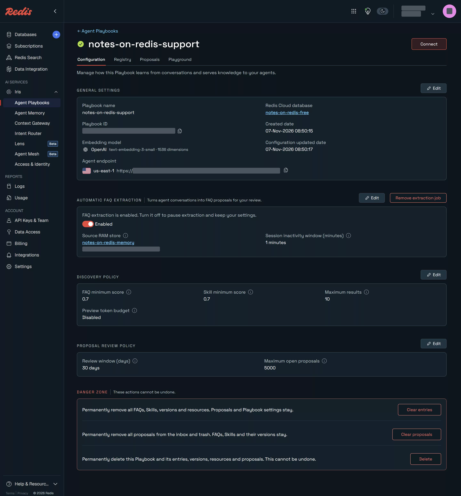

# Agent Playbooks

[English](#english) | [한국어](#한국어)

## English

**Verified on redis-iris 1.0.1 against Redis Cloud free plan services (endpoints in us-east-1, database in ap-northeast-2), 2026-11-07.**

A Playbook on the free database with four FAQs written from this site's own findings, authored as JSON files and synced with the `iris` CLI; discovery at runtime with the SDK; a proposal for a question nothing covers; and a second version that stays a draft until it is published.

Official documentation: [Agent Playbooks](https://redis.io/docs/latest/operate/iris/agent-playbook/)

### Run

```bash
set -a; . ./.env; set +a
.venv/bin/iris agent-playbooks faqs validate faqs
.venv/bin/iris agent-playbooks faqs plan faqs
.venv/bin/iris agent-playbooks faqs sync faqs --publish all
.venv/bin/python lab.py discover
.venv/bin/python lab.py propose
# edit faqs/free-plan-limits.json, then
.venv/bin/iris agent-playbooks faqs sync faqs          # new version, not published
.venv/bin/iris agent-playbooks faqs publish free-plan-limits --version 2
.venv/bin/python more.py skill      # package skills/redis-free-plan-check, upload, publish, discover, load
.venv/bin/python more.py proposal   # review, edit, accept and publish the open proposal
# console: Configuration > Create extraction job: source notes-on-redis-memory, inactivity 1 minute; turn it on
.venv/bin/python extract.py 20   # record a support conversation in Agent Memory and watch the inbox
```

Output as it appeared (2026-11-07; service ids and endpoints removed):

```text
$ iris agent-playbooks faqs sync faqs --publish all   (4 entries CREATE + PUBLISH, version 1)

$ lab.py discover
== discover
 1217 ms  'is encryption in transit available on the free tier?'       [('free-plan-tls', 0.75, 1)]
  614 ms  'how many clients can connect to the free database'          [('free-plan-limits', 0.76, 1), ('free-plan-tls', 0.71, 1)]
  587 ms  'MSET fails with a slot error on my cluster'                 [('crossslot-error', 0.85, 1)]
  581 ms  '무료 DB에서 TLS 켤 수 있어?'                                        [('free-plan-tls', 0.78, 1)]
  776 ms  'How do I configure Active-Active between Seoul and Tokyo?'  []

== propose
proposal: created None

$ iris agent-playbooks proposals list --view inbox
PROPOSAL ID                           STATE  REV  EVIDENCE  SCORE  CANDIDATE                                                
------------------------------------  -----  ---  --------  -----  ---------------------------------------------------------
<id>  OPEN   1    0         -      How do I configure Active-Active between Seoul and Tokyo?

$ iris agent-playbooks faqs sync faqs        (no --publish: the new version stays a draft)
APPLIED  APPEND  free-plan-limits  2              
NOOP     NOOP    free-plan-tls     1              
NOOP     NOOP    wait-semantics    1              
$ iris agent-playbooks faqs versions free-plan-limits
free-plan-limits  version 2
free-plan-limits  version 1
-- discover before publishing v2
free-plan-limits version 1 |  test on 2026-11-07. No replication, persistence or backups.
$ iris agent-playbooks faqs publish free-plan-limits --version 2
published free-plan-limits version 2
-- discover after publishing v2
free-plan-limits version 2 | rsistence or backups. TLS is not available on the free plan.
```

`more.py` output as it appeared (2026-11-07):

```text
$ .venv/bin/python more.py skill
package: 1595 bytes, files ['redis-free-plan-check/SKILL.md', 'redis-free-plan-check/references/limits.md']
uploaded: skill version 2, state None
published: 2
discover 'Will my app with 50 MB of sessions and 40 clients fit the free tier?'
   skills [('redis-free-plan-check', 0.75)] faqs [('free-plan-limits', 0.75)]
discover '무료 플랜에 TLS 필요한 서비스 올려도 돼?'
   skills [] faqs [('free-plan-tls', 0.73)]
discover 'How much does Essentials cost in Seoul?'
   skills [] faqs []
instructions (first line): 1. Collect three facts from the user: data size, peak client connections, and whether traffic must be encrypted. Ask for any that is missing.
resource references/limits.md (first line): Redis Cloud free plan, measured 2026-11-07 on this site (cloud/01-free-database):

$ .venv/bin/python more.py proposal
proposal ProposalState.OPEN, revision 1; draft answer: 'Draft: Active-Active needs Redis Cloud Pro; not run on this site yet.'
edited: revision 2
accepted: FAQ version 1 created (not yet live)
discover before publish: []
discover after publish:  [('active-active-seoul-tokyo', 0.91)]
proposal now: ProposalState.PROMOTED
```

`extract.py` output as it appeared (2026-11-07):

```text
recorded 4 events for cust-extract-a0e9fe in session cust-ext…; inbox had 0 open proposal(s)
   31 s  no new proposal yet
   62 s  no new proposal yet
   92 s  no new proposal yet
  123 s  no new proposal yet
  154 s  no new proposal yet
  186 s  no new proposal yet
  217 s  no new proposal yet
  248 s  no new proposal yet
  278 s  no new proposal yet
  310 s  new proposal, state ProposalState.OPEN, evidence 1
         question: Why can a Redis Cloud free database refuse writes with an OOM error when it contains only about 28 MB of values despite a 30 MB limit?
         answer:   The 30 MB limit includes Redis’s internal overhead, so writes may be refused at about 28 MB of stored values. Redis does not automatically evict keys without TTLs; delete keys, set TTLs, or upgrade to a paid plan for more memory.
```

### What was observed

- **Discovery.** Paraphrased English questions found the right FAQ at 0.75–0.85; the Korean "무료 DB에서 TLS 켤 수 있어?" found the English TLS FAQ at 0.78. The Active-Active question, which no FAQ covers, returned nothing rather than a weak match.
- **Proposals.** `propose_faq` put the uncovered question in the review inbox as OPEN; nothing reaches agents until a person accepts and publishes it.
- **Versions.** Editing an FAQ and syncing without `--publish` appended version 2 as a draft; discovery kept serving version 1 until `faqs publish --version 2`, then served version 2. The key's actions follow the same split: read, write, propose, publish, full.
- **Latency.** 580–1,220 ms per discovery from Korea; the agent endpoint is in us-east-1.
- **LangCache.** The console on 2026-11-07 lists Agent Playbooks and no LangCache entry; this site keeps treating them as two products (see the research notes).
- **A skill is a folder of instructions.** `skills/redis-free-plan-check` holds `SKILL.md` (name, description, steps) and `references/limits.md` with this site's measured limits, zipped to 1,595 bytes. `create_skill` stored version 1, `publish_skill` made it live, and a second upload became version 2. `discover` returned the skill (0.75) next to an FAQ (0.75) for an English sizing question, and nothing for a pricing question it should not answer. The Korean TLS question matched only the FAQ: the skill's description and intents are English.
- **An agent loads the instructions when it needs them.** `playbook.skill(...)` returned the steps, and `skill_resource` the reference file, by path.
- **Reviewing a proposal.** The open proposal from `lab.py propose` had the draft answer "Draft: Active-Active needs Redis Cloud Pro; not run on this site yet." `replace_proposal` rewrote it (revision 1 → 2), `accept_proposal` created FAQ version 1, which `discover` did not return until `publish_faq`; then it came first at 0.91. The proposal ended `PROMOTED`.
- **FAQ extraction from Agent Memory works on the free plan.** In the playbook's **Automatic FAQ extraction** section, an extraction job reads one whole Agent Memory service ("Source RAM store") after a session has been idle for the set window, 1 minute here. After a four-message support conversation about the 28 MB limit, a proposal with one piece of evidence appeared 310 s later. Its question and answer were rewritten as a general FAQ, without the customer's wording. It stays in the inbox for review, as extraction "never publishes them". The job was then turned off again, which keeps its settings.



Captured 2026-11-07, Redis Cloud free plan.

### Not run / caveats


| | |
|---|---|
| Plan needed | Free (Redis Cloud free database; Iris free messages) |
| Verified on | redis-iris 1.0.1 against Redis Cloud free plan services (endpoints in us-east-1, database in ap-northeast-2), 2026-11-07 |

## 한국어

**확인: redis-iris 1.0.1 against Redis Cloud free plan services (endpoints in us-east-1, database in ap-northeast-2), 2026-11-07.**

이 사이트의 발견으로 쓴 FAQ 네 개가 든 무료 DB 위의 Playbook. JSON 파일로 쓰고 `iris` CLI로 동기화한다. 실행 시에는 SDK로 찾고, 아무것도 다루지 않는 질문은 제안으로 넘기며, 두 번째 버전은 공개 전까지 초안으로 남는다.

공식 문서: [Agent Playbooks](https://redis.io/docs/latest/operate/iris/agent-playbook/)

### 실행

```bash
set -a; . ./.env; set +a
.venv/bin/iris agent-playbooks faqs validate faqs
.venv/bin/iris agent-playbooks faqs plan faqs
.venv/bin/iris agent-playbooks faqs sync faqs --publish all
.venv/bin/python lab.py discover
.venv/bin/python lab.py propose
# edit faqs/free-plan-limits.json, then
.venv/bin/iris agent-playbooks faqs sync faqs          # new version, not published
.venv/bin/iris agent-playbooks faqs publish free-plan-limits --version 2
.venv/bin/python more.py skill      # package skills/redis-free-plan-check, upload, publish, discover, load
.venv/bin/python more.py proposal   # review, edit, accept and publish the open proposal
# console: Configuration > Create extraction job: source notes-on-redis-memory, inactivity 1 minute; turn it on
.venv/bin/python extract.py 20   # record a support conversation in Agent Memory and watch the inbox
```

출력은 영문 절과 같다(2026-11-07).

`more.py`의 출력도 영문 절과 같다(2026-11-07).

`extract.py`의 출력도 영문 절과 같다(2026-11-07).

### 관찰한 것

- **검색.** 바꿔 말한 영어 질문이 0.75–0.85로 맞는 FAQ를 찾았다. 한국어 "무료 DB에서 TLS 켤 수 있어?"는 영어 TLS FAQ를 0.78로 찾았다. 어떤 FAQ도 다루지 않는 Active-Active 질문은 약한 매칭 대신 빈 결과였다.
- **제안.** `propose_faq`가 다루지 않는 질문을 검토함에 OPEN으로 넣었다. 사람이 받아들이고 공개하기 전에는 에이전트에 닿지 않는다.
- **버전.** FAQ를 고쳐 `--publish` 없이 동기화하자 버전 2가 초안으로 붙었다. `faqs publish --version 2` 전까지 검색은 버전 1을 냈고, 그 뒤 버전 2를 냈다. 키의 동작도 같은 구분을 따른다: read, write, propose, publish, full.
- **지연.** 한국에서 검색마다 580–1,220 ms. 에이전트 엔드포인트는 us-east-1이다.
- **LangCache.** 2026-11-07 콘솔에는 Agent Playbooks가 있고 LangCache 항목은 없다. 이 사이트는 둘을 계속 별개 제품으로 다룬다(조사 노트 참고).
- **Skill은 지시문 폴더다.** `skills/redis-free-plan-check`에는 `SKILL.md`(이름, 설명, 단계)와 이 사이트가 잰 한도를 담은 `references/limits.md`가 있고, 1,595바이트로 압축된다. `create_skill`이 버전 1을 저장했고, `publish_skill`로 공개했고, 두 번째 업로드는 버전 2가 됐다. 영어 용량 질문에는 `discover`가 FAQ(0.75)와 나란히 이 skill(0.75)을 돌려줬고, 답하면 안 되는 가격 질문에는 아무것도 돌려주지 않았다. 한국어 TLS 질문에는 FAQ만 매칭됐다. skill의 설명과 의도가 영어이기 때문이다.
- **에이전트는 필요할 때 지시문을 불러온다.** `playbook.skill(...)`이 단계를, `skill_resource`가 참조 파일을 경로로 돌려줬다.
- **제안 검토.** `lab.py propose`가 만든 열린 제안의 초안 답은 "Draft: Active-Active needs Redis Cloud Pro; not run on this site yet."였다. `replace_proposal`로 고쳐 쓰고(리비전 1 → 2), `accept_proposal`이 FAQ 버전 1을 만들었다. `publish_faq` 전에는 `discover`가 이것을 돌려주지 않았고, 게시 뒤 0.91로 1위가 됐다. 제안은 `PROMOTED`로 끝났다.
- **Agent Memory에서의 FAQ 추출은 무료 플랜에서 된다.** 플레이북의 **Automatic FAQ extraction** 절에서 추출 작업은 Agent Memory 서비스 하나 전체("Source RAM store")를 읽는데, 세션이 정해진 시간(여기서는 1분) 동안 조용하면 대상이 된다. 28 MB 한도에 관한 메시지 넷짜리 상담 대화를 기록하고 310초 뒤 증거 한 건이 붙은 제안이 나타났다. 질문과 답은 고객의 말투 없이 일반적인 FAQ로 다시 쓰여 있었다. 추출은 "never publishes them"이라 검토를 위해 제안함에 남아 있다. 작업은 다시 껐고, 설정은 유지된다.


2026-11-07 캡처, Redis Cloud 무료 플랜.

### 미실행 / 주의


| | |
|---|---|
| 필요한 플랜 | Free(Redis Cloud 무료 DB, Iris 무료 메시지) |
| 확인한 버전 | redis-iris 1.0.1 against Redis Cloud free plan services (endpoints in us-east-1, database in ap-northeast-2), 2026-11-07 |
