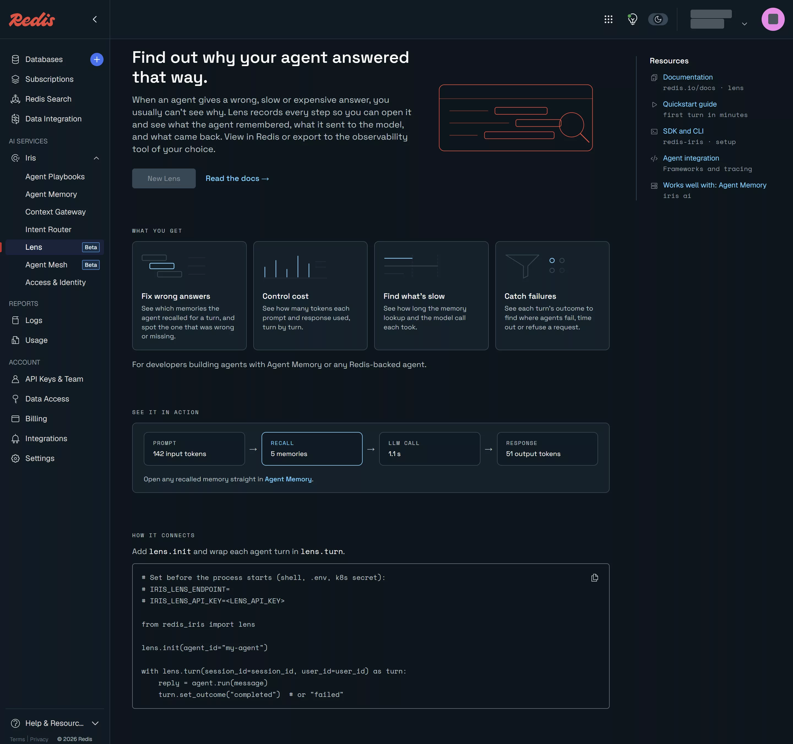

# Lens and Agent Mesh

[English](#english) | [한국어](#한국어)

## English

**Verified on redis-iris 1.0.1 (fastapi-redis-sdk 0.10.0b1, a2a-sdk 1.2.3, redis-py 8.1.0), Redis 8.10.3 (`redis:8.10.3`), 2026-11-07.** Agent Mesh ran end to end on local Redis. Lens ran only as far as its SDK: Lens itself was not created (see the caveats).

Both services are beta. **Agent Mesh** keeps an agent's progress events in a Redis stream so a client that disconnects can come back, to the same server or another one, and receive what it missed. From the overview: "Your application keeps producing events when a client disconnects. When the client reconnects, it can receive retained updates after its last event cursor." Its requirements: "native producer idempotency (XADD IDMP)", the Redis 8.6 feature measured in [`deep-dive/07-streams`](../../deep-dive/07-streams/README.md). And: "Cloud, Enterprise, failover recovery, and sustained capacity remain unqualified for this beta."

**Lens** traces agent turns: "For each turn, Lens records what each source returned, such as a memory recall or a retrieval, and what entered the prompt." It is "Built on OpenTelemetry". On Redis Cloud it needs a records database that is "A Redis Cloud Essentials or Pro database."

Official documentation: [Agent Mesh](https://redis.io/docs/latest/develop/ai/context-engine/agent-mesh/), [Agent Mesh quickstart](https://redis.io/docs/latest/develop/ai/context-engine/agent-mesh/quickstart/), [FastAPI SSE SDK guide](https://redis.io/docs/latest/develop/ai/context-engine/agent-mesh/fastapi-sse-sdk/), [A2A SDK guide](https://redis.io/docs/latest/develop/ai/context-engine/agent-mesh/a2a-sdk/), [Lens](https://redis.io/docs/latest/develop/ai/context-engine/lens/), [Create Lens](https://redis.io/docs/latest/operate/iris/lens/create-lens/), [Instrument an agent](https://redis.io/docs/latest/develop/ai/context-engine/lens/instrument/).

### Run

```bash
python3 -m venv .venv      # Python 3.11+; the lab used 3.12 through uv
.venv/bin/pip install 'redis-iris[a2a,fastapi-sse,llm-tracing]==1.0.1' uvicorn httpx
.venv/bin/python mesh_lab.py      # Agent Mesh: local Redis 8.10.3 in Docker, four app processes, about 3 minutes
.venv/bin/python lens_local.py    # Lens SDK against a loopback receiver; reads ../02-agent-memory/.env
node ../../scripts/capture-console.mjs capture.json   # console screens, from the repository root
```

Agent Mesh output as it appeared (2026-11-07). The apps are `mesh_sse_app.py` and `mesh_a2a_app.py`, adapted from the two quickstart demos.

```text
redis 8.10.3

== 1. FastAPI SSE: start on replica A (18101), read 5 events, disconnect
   POST /jobs on A -> {'job_id': 'a289e552…', 'started_on': 18101}
   A  id=1794045495837-0 progress {"step": 1, "by": 18101}
   A  id=1794045496339-0 progress {"step": 2, "by": 18101}
   A  id=1794045496842-0 progress {"step": 3, "by": 18101}
   A  id=1794045497344-0 progress {"step": 4, "by": 18101}
   A  id=1794045497846-0 progress {"step": 5, "by": 18101}
   disconnected for 3.0 s; saved cursor 1794045497846-0

== reconnect to replica B (18102) with Last-Event-ID
   status 200
   B  id=1794045505370-1 completed {"count": 20, "by": 18101}
   steps before disconnect [1, 2, 3, 4, 5]
   steps after reconnect   [6, 7, 8, 9, 10, 11, 12, 13, 14, 15, 16, 17, 18, 19, 20]
   arrived at once (replayed): [6, 7, 8, 9, 10, 11]; then live from step 12
   all 20 exactly once: True
   reconnect with final cursor     -> HTTP 204 
   reconnect with malformed cursor -> HTTP 422 {"detail":"invalid cursor 'not-a-cursor'","code":"invalid_cursor"}
   reconnect with unknown run      -> HTTP 404 {"detail":"no stream 71d1d6bb-19c2-426b-b886-556ae055a158 in this scope","code":"stream_no

== what is in Redis
   lab:sse:stream:job:<job>:<job> stream ttl=120 XLEN 22, idmp keys ['idmp-duration', 'idmp-maxsize']

== 2. the producer's replica dies; SDK defaults (heartbeat 15 s, silence 60 s, socket timeout unset)
    0.0 s  B has read 3 events; replica A killed (SIGKILL)
    35.0 s  connection closed by B
    35.0 s  reconnect -> HTTP 200
    70.0 s  connection closed by B
    70.1 s  reconnect -> HTTP 200
   105.1 s  connection closed by B
   past 75 s with no final event; stopped watching
   redis-py 8.1.0 default socket_timeout: 5

== 2b. the same with REDIS_SOCKET_TIMEOUT=30 (and heartbeat 5 s, silence 12 s to keep it short)
    0.0 s  B has read 3 events; replica A killed (SIGKILL)
    15.0 s  stream.end {"reason": "producer_lost"}
    15.0 s  connection closed by B
    15.1 s  reconnect -> HTTP 204

== 3. A2A: task started on replica A (18201), resumed on replica B (18202)
   POST /message:send on A -> task 37e934fc… TASK_STATE_WORKING
   A  id=1 task [] TASK_STATE_WORKING
   A  id=2 artifactUpdate ['update-1'] 
   A  id=3 artifactUpdate ['update-2'] 
   A  id=4 artifactUpdate ['update-3'] 
   disconnected 2 s; saved cursor (Task version) 4
   B  id=5 artifactUpdate ['update-4'] 
   B  id=6 artifactUpdate ['update-5'] 
   B  id=7 artifactUpdate ['update-6'] 
   B  id=8 artifactUpdate ['update-7'] 
   B  id=9 artifactUpdate ['update-8'] 
   B  id=10 artifactUpdate ['update-9'] 
   B  id=11 artifactUpdate ['update-10'] 
   B  id=12 statusUpdate [] TASK_STATE_COMPLETED
   artifacts received 10, distinct 10: all 10 exactly once = True
   reconnect at the final version -> HTTP 204

== what is in Redis
   iris:a2a:{a47d9d36d9cd9dab4cb160a6f3198075:c882345e7805a4f6fe5a87aa0cd7e787}:events stream ttl=86400
   iris:a2a:{a47d9d36d9cd9dab4cb160a6f3198075:c882345e7805a4f6fe5a87aa0cd7e787}:meta hash ttl=172800
   iris:a2a:{a47d9d36d9cd9dab4cb160a6f3198075:c882345e7805a4f6fe5a87aa0cd7e787}:snapshot ReJSON-RL ttl=86400
   iris:a2a:{a47d9d36d9cd9dab4cb160a6f3198075:lease:3b441fe7e018de1a} hash ttl=-1
   iris:a2a:{a47d9d36d9cd9dab4cb160a6f3198075:owner:00a3816fbe1032315f2574b9d834180b}:tasks zset ttl=691200
```

Lens output as it appeared (2026-11-07), content capture on (the default):

```text
lens.init -> True
turn trace id: efe41a84a0301ee5978854326bcc7468 | memories recalled: 0

POST /iris/data/v1beta1/lens/v1/traces  auth header: True  content-type: application/x-protobuf
resource: {'telemetry.sdk.name': 'opentelemetry', 'service.instance.id': '4450f44f-e7c9-43d1-9a22-4d8326a0f8a5', 'service.name': 'unknown_service'}
- iris.lens.turn  (parent: -, 1240 ms)
    gen_ai.agent.id = "notes-on-redis-lab"
    gen_ai.conversation.id = "lens-local-1"
    iris.agent.id = "notes-on-redis-lab"
    iris.lens.export_failures = 0
    iris.lens.identifiers_truncated = 0
    iris.lens.identity_unassigned = 0
    iris.lens.instance.id = "08680b2389704f3cb9368899ba1c83ce"
    iris.lens.instance.start_time_unix_nano = 1794045479427371887
    iris.lens.invalid_outcomes = 0
    iris.lens.sdk.version = "0.2.0"
    iris.lens.spans_dropped_filtered = 0
    iris.lens.spans_exported = 0
    iris.lens.spans_forwarded = 3
    iris.lens.spans_normalized = 0
    iris.lens.spans_seen = 4
    iris.lens.tool_bodies_deduped = 0
    iris.lens.turn_violations = 0
    iris.session.id = "lens-local-1"
    iris.thread.id = "lens-local-1"
    iris.turn.outcome = "completed"
    iris.user.id = "cust-2001"
- iris.lens.retrieval  (parent: iris.lens.turn, 1239 ms)
    gen_ai.data_source.id = "<store-id>"
    gen_ai.operation.name = "retrieval"
    gen_ai.retrieval.query.text = "how big should my Redis Cloud database be"
    iris.agent.id = "notes-on-redis-lab"
    iris.component.name = "agent_memory"
    iris.component.operation = "search_long_term_memory"
    iris.component.resource.id = "<store-id>"
    iris.lens.capture.state = "omitted_unsupported"
    iris.lens.integration.version = 1
    iris.lens.sdk.version = "0.2.0"
    iris.memory.has_next_page = false
    iris.memory.request.filter_fields = ["ownerId"]
    iris.memory.request.limit = 3
    iris.memory.request.paginated = false
    iris.retrieval.document.count = 0
    iris.retrieval.kind = "memory"
    iris.retrieval.stage = "search"
    iris.session.id = "lens-local-1"
    iris.thread.id = "lens-local-1"
    iris.user.id = "cust-2001"
- iris.lens.retrieval  (parent: iris.lens.turn, 0 ms)
    gen_ai.data_source.id = "help-center"
    gen_ai.operation.name = "retrieval"
    gen_ai.retrieval.query.text = "free plan limits"
    iris.agent.id = "notes-on-redis-lab"
    iris.lens.sdk.version = "0.2.0"
    iris.retrieval.document.count = 2
    iris.retrieval.documents = "[{\"id\": \"doc-free-plan\", \"score\": 0.91, \"hash\": \"a907a48ed2c90aa698df4c973a82dbfbb607ff6695b9c17de9740b7f05057ed9\", \"text\": \"The free plan has 30 MB and 30 connections.\"}, {\"id\": \"doc-tls\", \"score\": 0.42, \"hash\": \"56a5e1ad62dbaab757700a97abe627c5073f7db6a209c44a7444eee7f8bd5f25\", \"text\": \"TLS needs a paid plan.\"}]"
    iris.retrieval.kind = "document"
    iris.session.id = "lens-local-1"
    iris.thread.id = "lens-local-1"
    iris.user.id = "cust-2001"
- rank-and-answer  (parent: iris.lens.turn, 0 ms)
    app.answer_chars = 64
    candidates = 2
    iris.agent.id = "notes-on-redis-lab"
    iris.lens.sdk.version = "0.2.0"
    iris.session.id = "lens-local-1"
    iris.thread.id = "lens-local-1"
    iris.user.id = "cust-2001"
```



Captured 2026-11-07 on the free plan: **New Lens** is disabled.

### What was observed

- **Resume on another replica (SSE).** Replica A ran the producer. The client read steps 1–5 from A, was away 3 s, and reconnected to replica B with `Last-Event-ID`. B replayed steps 6–11 at once, then followed 12–20 live. All 20 steps arrived exactly once. The cursor is the Redis stream entry ID.
- **Reconnect answers.** At the final cursor: HTTP 204, stop reconnecting. A malformed cursor: 422 `invalid_cursor`. An unknown run: 404. These match the guide's table.
- **One run is one stream.** 20 progress entries, one final entry and one SDK entry made `XLEN 22`. `XINFO STREAM` shows `idmp-duration` and `idmp-maxsize`, so the SDK writes with IDMP. TTL 120 s after completion, the default `STREAM_DONE_TTL`.
- **The producer's replica dying, with defaults: no final event.** After A was killed, B never wrote `producer_lost`. Every 35 s B closed the connection and the client reconnected, with no end. The cause: redis-py 8.1.0 sets `socket_timeout` to 5 s by default, shorter than the SDK's 15 s blocking read. Every read times out, the SDK treats it as Redis being unreachable, and that resets the silence clock. After 30 s of that (`STREAM_READ_RETRY_WINDOW`) it closes the connection. The guide says to keep `REDIS_SOCKET_TIMEOUT` "unset, or longer than `REDIS_STREAM_HEARTBEAT_INTERVAL`"; unset is not enough with this redis-py.
- **With `REDIS_SOCKET_TIMEOUT=30`** the same failure ended properly: `stream.end {"reason": "producer_lost"}` 15 s after the kill (silence timeout 12 s plus a heartbeat), then 204 on reconnect. The same setting with the default 60 s silence timeout gave `producer_lost` at 60.2 s in a separate run.
- **A2A resume on another replica.** A task started on A; the client read Task versions 1–4 from A, then reconnected to B with `Last-Event-ID: 4`. B sent versions 5–12 and the completed status: ten artifacts, each once. Here the cursor is the Task version, not a stream entry ID.
- **A2A keys.** The store keeps an `events` stream, a `snapshot` JSON document and a `meta` hash per task, a per-owner task index, and a process lease. The namespace and the owner appear only as the first 32 hex digits of their SHA-256, inside a hash tag, so one task's keys share a cluster slot. Terminal tasks live 86,400 s, the `terminal_ttl` default. The lease hash had no TTL after the processes stopped.
- **Lens without Lens.** With `IRIS_LENS_ENDPOINT` unset, `lens.init()` returns `False` and every call is a no-op. Pointed at a loopback receiver, the SDK sent one OTLP/HTTP protobuf request with a bearer key to `/iris/data/v1beta1/lens/v1/traces`. One turn produced four spans: the turn, the Agent Memory search (recorded by the SDK with no extra code, as `iris.component.name = agent_memory`), the app's own retrieval, and a custom step.
- **Content capture.** With it on, the retrieval carries query text and each document's text. With `IRIS_LENS_CAPTURE_CONTENT=false` both texts disappear and documents keep only ID, score and a SHA-256 hash.

### Not run / caveats

- **Lens itself was not created.** Its records database must be Essentials or Pro, and this account only has the free database, so the console's **New Lens** is disabled. Reading turns back (`redis-agent-lens`), the Lens UI and model-call tracing wait for the Essentials budget in [#8](https://github.com/litkhai/notes-on-redis/issues/8).
- Agent Mesh ran on local Redis only. The quickstart's Redis Cloud path needs TLS, which the free plan does not offer, and the docs list Cloud as unqualified for the beta.
- A2A hand-off of a running task to another process (`takeover=True`) was not run.

| | |
|---|---|
| Plan needed | Free for Agent Mesh (local Docker); Essentials or Pro for Lens |
| Verified on | redis-iris 1.0.1 (fastapi-redis-sdk 0.10.0b1, a2a-sdk 1.2.3, redis-py 8.1.0), Redis 8.10.3 (`redis:8.10.3`), 2026-11-07 |

## 한국어

**확인: redis-iris 1.0.1 (fastapi-redis-sdk 0.10.0b1, a2a-sdk 1.2.3, redis-py 8.1.0), Redis 8.10.3 (`redis:8.10.3`), 2026-11-07.** Agent Mesh는 로컬 Redis에서 끝까지 실행했다. Lens는 SDK까지만 실행했고 Lens 자체는 만들지 않았다(주의 참조).

둘 다 베타다. **Agent Mesh**는 에이전트의 진행 이벤트를 Redis 스트림에 담아 두어, 끊긴 클라이언트가 같은 서버든 다른 서버든 돌아와서 놓친 것을 받게 한다. 개요의 표현: "Your application keeps producing events when a client disconnects. When the client reconnects, it can receive retained updates after its last event cursor." 요구 사항은 "native producer idempotency (XADD IDMP)"로, [`deep-dive/07-streams`](../../deep-dive/07-streams/README.md)에서 측정한 Redis 8.6 기능이다. 또 "Cloud, Enterprise, failover recovery, and sustained capacity remain unqualified for this beta."

**Lens**는 에이전트 턴을 추적한다: "For each turn, Lens records what each source returned, such as a memory recall or a retrieval, and what entered the prompt." "Built on OpenTelemetry"이다. Redis Cloud에서는 기록용 DB가 "A Redis Cloud Essentials or Pro database"여야 한다.

공식 문서: [Agent Mesh](https://redis.io/docs/latest/develop/ai/context-engine/agent-mesh/), [Agent Mesh quickstart](https://redis.io/docs/latest/develop/ai/context-engine/agent-mesh/quickstart/), [FastAPI SSE SDK guide](https://redis.io/docs/latest/develop/ai/context-engine/agent-mesh/fastapi-sse-sdk/), [A2A SDK guide](https://redis.io/docs/latest/develop/ai/context-engine/agent-mesh/a2a-sdk/), [Lens](https://redis.io/docs/latest/develop/ai/context-engine/lens/), [Create Lens](https://redis.io/docs/latest/operate/iris/lens/create-lens/), [Instrument an agent](https://redis.io/docs/latest/develop/ai/context-engine/lens/instrument/).

### 실행

```bash
python3 -m venv .venv      # Python 3.11+; the lab used 3.12 through uv
.venv/bin/pip install 'redis-iris[a2a,fastapi-sse,llm-tracing]==1.0.1' uvicorn httpx
.venv/bin/python mesh_lab.py      # Agent Mesh: local Redis 8.10.3 in Docker, four app processes, about 3 minutes
.venv/bin/python lens_local.py    # Lens SDK against a loopback receiver; reads ../02-agent-memory/.env
node ../../scripts/capture-console.mjs capture.json   # console screens, from the repository root
```

출력은 영문 절과 같다(2026-11-07). 앱 `mesh_sse_app.py`와 `mesh_a2a_app.py`는 빠른 시작 데모 둘을 고친 것이다.


2026-11-07 무료 플랜에서 촬영: **New Lens**가 비활성이다.

### 관찰한 것

- **다른 복제본에서 이어 받기(SSE).** 복제본 A가 생산자를 돌렸다. 클라이언트는 A에서 1–5단계를 읽고 3초 떠났다가 `Last-Event-ID`로 복제본 B에 다시 붙었다. B는 6–11단계를 한꺼번에 재생하고 12–20단계를 실시간으로 따라갔다. 20단계가 모두 정확히 한 번씩 왔다. 커서는 Redis 스트림 항목 ID다.
- **재연결 응답.** 마지막 커서면 HTTP 204(재연결 중단). 잘못된 커서는 422 `invalid_cursor`, 모르는 실행은 404. 가이드의 표와 같다.
- **실행 하나가 스트림 하나.** 진행 항목 20개, 최종 항목 1개, SDK 항목 1개로 `XLEN 22`. `XINFO STREAM`에 `idmp-duration`과 `idmp-maxsize`가 보이니 SDK는 IDMP로 쓴다. 완료 뒤 TTL 120초, `STREAM_DONE_TTL` 기본값이다.
- **생산자 복제본이 죽으면, 기본 설정에서는 최종 이벤트가 오지 않는다.** A를 죽인 뒤 B는 `producer_lost`를 끝내 쓰지 않았다. B가 35초마다 연결을 닫고 클라이언트가 다시 붙기를 끝없이 반복했다. 원인: redis-py 8.1.0은 `socket_timeout` 기본값이 5초로, SDK의 15초 블로킹 읽기보다 짧다. 읽기가 매번 시간 초과로 끝나고, SDK는 이를 Redis 장애로 보고 침묵 시계를 초기화한다. 그렇게 30초(`STREAM_READ_RETRY_WINDOW`)가 지나면 연결을 닫는다. 가이드는 `REDIS_SOCKET_TIMEOUT`을 "unset, or longer than `REDIS_STREAM_HEARTBEAT_INTERVAL`"로 두라고 하지만, 이 redis-py에서는 설정하지 않는 것만으로는 부족하다.
- **`REDIS_SOCKET_TIMEOUT=30`이면** 같은 장애가 제대로 끝났다: 죽인 뒤 15초에 `stream.end {"reason": "producer_lost"}`(침묵 제한 12초 + 하트비트 한 번), 재연결은 204. 같은 설정에 기본 침묵 제한 60초로 따로 돌린 실행에서는 60.2초에 `producer_lost`가 왔다.
- **A2A도 다른 복제본에서 이어 받는다.** A에서 태스크를 시작하고 클라이언트가 Task 버전 1–4를 A에서 읽은 뒤 `Last-Event-ID: 4`로 B에 붙었다. B가 버전 5–12와 완료 상태를 보냈다. 아티팩트 10개가 각각 한 번씩. 여기서 커서는 스트림 항목 ID가 아니라 Task 버전이다.
- **A2A 키.** 태스크마다 `events` 스트림, `snapshot` JSON 문서, `meta` 해시를 두고, 소유자별 태스크 인덱스와 프로세스 임대 키가 있다. 네임스페이스와 소유자는 SHA-256 앞 32자로만 나타나고 해시 태그 안에 있어 한 태스크의 키가 같은 클러스터 슬롯에 모인다. 종료된 태스크는 86,400초 유지(`terminal_ttl` 기본값). 프로세스가 멈춘 뒤에도 임대 해시에는 TTL이 없었다.
- **Lens 없이 본 Lens.** `IRIS_LENS_ENDPOINT`가 없으면 `lens.init()`은 `False`를 돌려주고 모든 호출이 아무 일도 하지 않는다. 루프백 수신기를 가리키게 하자 SDK는 bearer 키를 붙인 OTLP/HTTP protobuf 요청 하나를 `/iris/data/v1beta1/lens/v1/traces`로 보냈다. 턴 하나에 스팬 넷: 턴, Agent Memory 검색(코드를 더하지 않아도 SDK가 `iris.component.name = agent_memory`로 기록), 앱 자체 검색, 사용자 정의 단계.
- **내용 캡처.** 켜면 검색 스팬에 질의 텍스트와 문서마다의 텍스트가 실린다. `IRIS_LENS_CAPTURE_CONTENT=false`면 두 텍스트가 사라지고 문서에는 ID, 점수, SHA-256 해시만 남는다.

### 미실행 / 주의

- **Lens 자체는 만들지 않았다.** 기록용 DB가 Essentials나 Pro여야 하는데 이 계정에는 무료 DB뿐이라 콘솔의 **New Lens**가 비활성이다. 턴 읽기(`redis-agent-lens`), Lens UI, 모델 호출 추적은 [#8](https://github.com/litkhai/notes-on-redis/issues/8)의 Essentials 예산을 기다린다.
- Agent Mesh는 로컬 Redis에서만 돌렸다. 빠른 시작의 Redis Cloud 경로는 TLS가 필요한데 무료 플랜에는 없고, 문서도 Cloud를 베타 검증 범위 밖으로 둔다.
- 실행 중인 A2A 태스크를 다른 프로세스로 넘기기(`takeover=True`)는 실행하지 않았다.

| | |
|---|---|
| 필요한 플랜 | Agent Mesh는 Free(로컬 Docker), Lens는 Essentials 또는 Pro |
| 확인한 버전 | redis-iris 1.0.1 (fastapi-redis-sdk 0.10.0b1, a2a-sdk 1.2.3, redis-py 8.1.0), Redis 8.10.3 (`redis:8.10.3`), 2026-11-07 |
